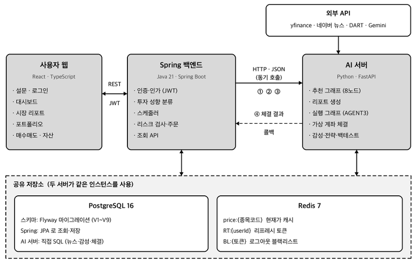
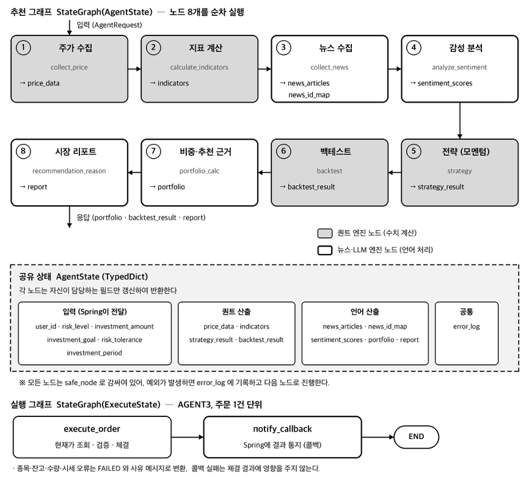
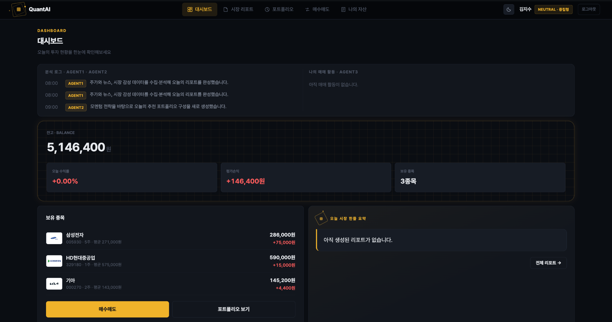
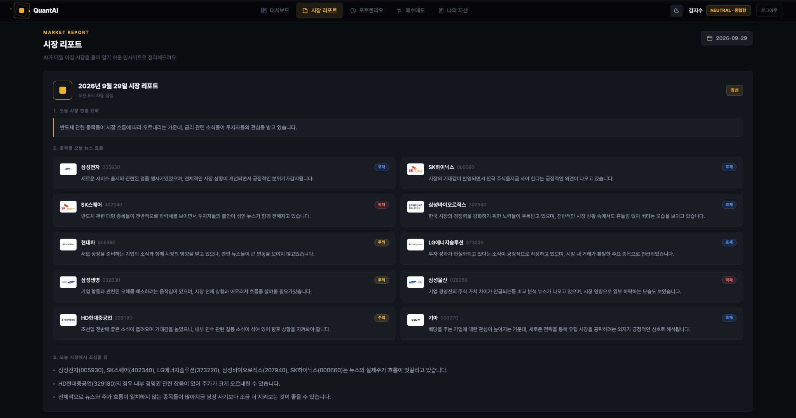
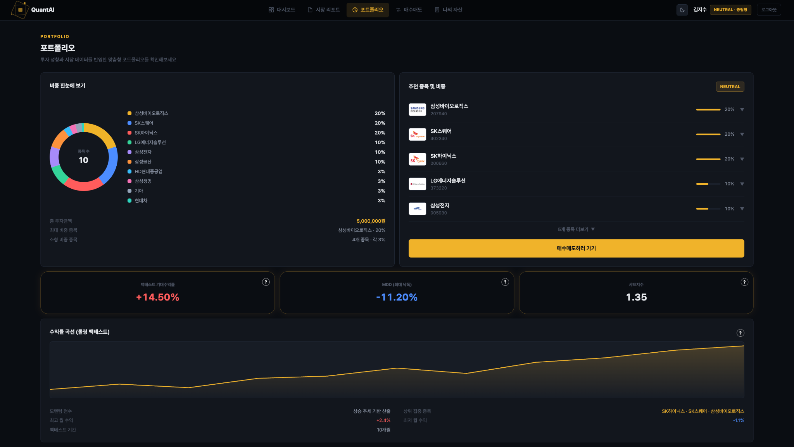
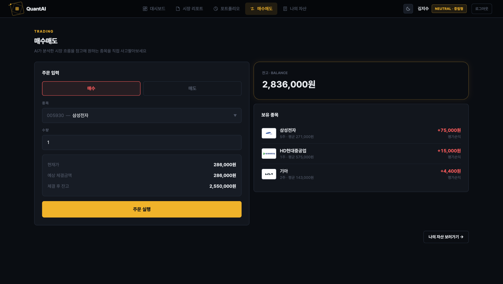
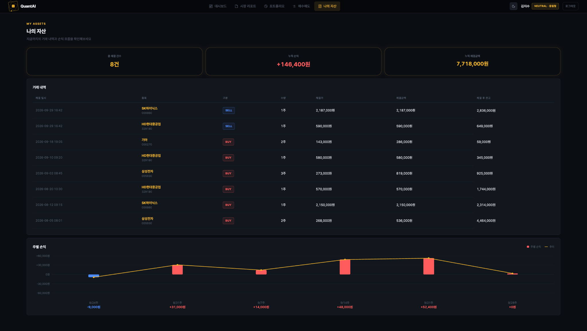
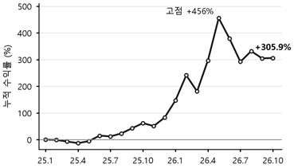

# QuantAI

**Multi-Agent 기반 맞춤형 퀀트 투자·리포팅 서비스**

모멘텀 퀀트 전략과 LLM 뉴스 감성 분석을 하나의 파이프라인으로 묶어, 
투자 성향에 맞는 포트폴리오와 **"왜 이 종목인지"에 대한 근거**를 함께 제공합니다.

---

## 프로젝트 소개

개인 투자자는 주가(수치)와 뉴스(언어)라는 성격이 전혀 다른 정보를 직접 종합해야 하고, 기존 로보어드바이저는 추천 결과만 보여 주는 블랙박스 구조라 추천 근거를 설명하지 못합니다.

QuantAI는 **수치 계산은 퀀트 엔진이, 언어 처리는 LLM이** 맡도록 역할을 분리한 Multi-Agent 파이프라인으로 이 문제를 해결합니다. LangGraph `StateGraph` 위에서 8개 노드가 공유 상태를 주고받으며 주가 수집 → 감성 분석 → 모멘텀 전략 → 백테스트 → 포트폴리오 비중 → 추천 근거 → 시장 리포트를 순서대로 생성합니다.

> 2026 졸업 프로젝트 · 대상: 국내 유가증권시장 대형주 10종목 · 모의투자 서비스

---

## 주요 기능

### 1. AI 시장 리포트 — `AGENT1`
네이버 뉴스·DART 공시를 수집하고 Gemini로 종목별 감성 점수(−1.0 ~ +1.0)를 매겨, **평일 08:00마다** 시장 한 줄 요약 · 종목별 뉴스 흐름 · 주의 종목으로 구성된 리포트를 자동 생성합니다.

### 2. 성향 맞춤 포트폴리오 추천 — `AGENT2`
3·6·12개월 수익률 가중합 **모멘텀 점수**로 종목 순위를 매기고, 투자 성향(공격형·중립형·안정형)과 투자 기간 조합에 따라 비중을 배분합니다. 종목마다 **사용자의 목표·기간을 반영한 추천 근거**와 롤링 백테스트 결과(누적 수익률·MDD·샤프 지수)를 함께 제공합니다.

| 조건 | 배분 기준 | 비중 규칙 |
|---|---|---|
| AGGRESSIVE 또는 5년 이상 | 모멘텀 순위 | 상위 3종목 60% / 중위 3종목 30% / 하위 4종목 10% |
| STABLE 또는 1년 미만 | 감성 점수 | positive 상위 5종목 70% / 나머지 30% |
| NEUTRAL (5년 이상 제외) | 균등 | 10종목 각 10% |

### 3. 리스크 관리 모의 매매 — `AGENT3`
초기 잔고 1,000만 원의 가상 계좌로 매수·매도할 수 있습니다. 주문은 Spring에서 **손실 한도(-15%) · 일일 거래 횟수(10회) · 단일 종목 집중도(20%)** 리스크 검사를 통과해야 AI 서버에서 체결되며, 체결은 잔고·보유 종목·거래 내역을 하나의 트랜잭션으로 처리합니다.

---

## 시스템 아키텍처

  

- **사용자 웹 (React)** — 설문, 대시보드, 리포트, 포트폴리오, 매수매도
- **Spring 백엔드** — 인증·인가(JWT), 투자 성향 분류, 스케줄러, 리스크 검사·주문 처리
- **AI 서버 (FastAPI)** — 수집·감성 분석·전략·백테스트, 포트폴리오·리포트 생성, 가상 계좌 체결
- 두 서버는 **PostgreSQL**(스키마는 Flyway 관리)과 **Redis**(현재가 캐시, 토큰)를 공유합니다.

| 번호 | 방향 | 경로 | 트리거 |
|:---:|---|---|---|
| ① | Spring → AI | `POST /api/portfolio/recommend` | 매월 1일 09:00 (사용자별) |
| ② | Spring → AI | `POST /report/generate` | 평일 08:00 |
| ③ | Spring → AI | `POST /api/portfolio/execute` | 사용자 주문 (리스크 검사 통과 후) |
| ④ | AI → Spring | `POST /internal/orders/status` | 체결 직후 콜백 |

### Multi-Agent 파이프라인

  

| 에이전트 | 역할 | 담당 노드 | 산출물 |
|---|---|---|---|
| **AGENT1** | 시장 분석·리포트 | ① 주가 수집 ② 지표 계산 ③ 뉴스 수집 ④ 감성 분석 ⑧ 시장 리포트 | 시장 리포트, 종목별 감성 점수 |
| **AGENT2** | 포트폴리오 추천 | ⑤ 모멘텀 전략 ⑥ 롤링 백테스트 ⑦ 비중·추천 근거 | 종목별 비중·금액·근거, 백테스트 결과 |
| **AGENT3** | 주문 실행 | `execute_order` → `notify_callback` | 체결가·금액·잔고 |

- 회색 노드는 **퀀트 엔진(수치 계산)**, 흰색 노드는 **뉴스·LLM 엔진(언어 처리)** 입니다.
- 모든 노드는 `safe_node` 래퍼로 감싸져 있어 한 노드에서 예외가 나도 `error_log`에 기록하고 다음 노드로 진행합니다.

---

## 서비스 화면

| 대시보드 | 시장 리포트 |
|:---:|:---:|
|  |  |
| 총자산·수익률·보유 종목·에이전트 활동 로그 | 날짜별 리포트, 종목별 뉴스 흐름과 톤 배지 |

| 포트폴리오 | 매수매도 |
|:---:|:---:|
|  |  |
| 비중 도넛 차트, 종목별 추천 근거, 백테스트 지표 | 예상 체결금액, 리스크 차단 사유 표시 |

| 나의 자산 | 백테스트 누적 수익률 |
|:---:|:---:|
|  |  |
| 체결 내역, 누적 손익, 주별 손익 차트 | 2025.01 ~ 2026.10 · 누적 +305.9% · MDD -29.5% · 샤프 1.54 |

> 백테스트는 상위 3종목 동일 비중 전략에 대한 과거 성과로, 생존 편향이 있고 거래비용·세금을 반영하지 않았습니다. 미래 수익을 보장하지 않습니다.

---

## 팀원 및 역할

| 이름 | GitHub | 역할 | 담당 |
|:---:|:---:|---|---|
| **권희재** | [@haileybaileyo](https://github.com/haileybaileyo) | 퀀트 엔진 | 주가 수집·검증, 기술 지표, 모멘텀 전략, 롤링 백테스트 |
| **이주원** | [@jwdebbie](https://github.com/jwdebbie) | 뉴스·LLM 엔진 | 뉴스·공시 수집, 감성 분석, 포트폴리오 비중·추천 근거, 시장 리포트, 가상 매매 |
| **이현정** | [@hyhy-j](https://github.com/hyhy-j) | 시스템 설계 · 백엔드 · 프론트엔드 | 아키텍처·DB 설계, Spring 백엔드(인증·스케줄러·리스크 검사), React 웹 |

---

## 레포지토리 구조

| 레포지토리 | 설명 | 담당 |
|---|---|---|
| [**AI**](https://github.com/QuantAI2026/AI) | Python · FastAPI · LangGraph 기반 AI 서버 (추천 그래프 8노드, 실행 그래프) | 이주원, 권희재 |
| [**BE**](https://github.com/QuantAI2026/Quant-BE.git) | Spring Boot 백엔드 (인증, 스케줄러, 리스크 검사, 주문 API) | 이현정 |
| [**FE**](https://github.com/QuantAI2026/Quant-FE.git) | React · TypeScript 사용자 웹 | 이현정 |

각 레포지토리의 README에서 실행 방법, 환경변수, API 명세를 확인할 수 있습니다.

---

## 기술 스택

| 구분 | 기술 |
|---|---|
| **Frontend** | React 19, TypeScript 6.0, Vite 8, Tailwind CSS 4, React Router 7 |
| **Backend** | Java 21, Spring Boot 4.0.6, Spring Security, JJWT 0.12.6, Spring Data JPA, Flyway, Spring Data Redis, springdoc-openapi |
| **AI Server** | Python 3.11, FastAPI 0.136, Uvicorn, LangGraph 1.2, pandas 3.0, NumPy 2.4, yfinance, google-genai, psycopg2 |
| **LLM** | Gemini 3.1 Flash-Lite (감성 분석, 추천 근거, 시장 리포트) |
| **Database** | PostgreSQL 16, Redis 7 |
| **External API** | yfinance, 네이버 뉴스 검색 API, DART OpenAPI, Gemini API |
| **Infra** | Docker, Docker Compose, GitHub Actions (amd64/arm64 이미지 빌드·게시) |

---

본 서비스는 학습·연구 목적의 **모의투자** 서비스이며, 투자 권유가 아닙니다.

